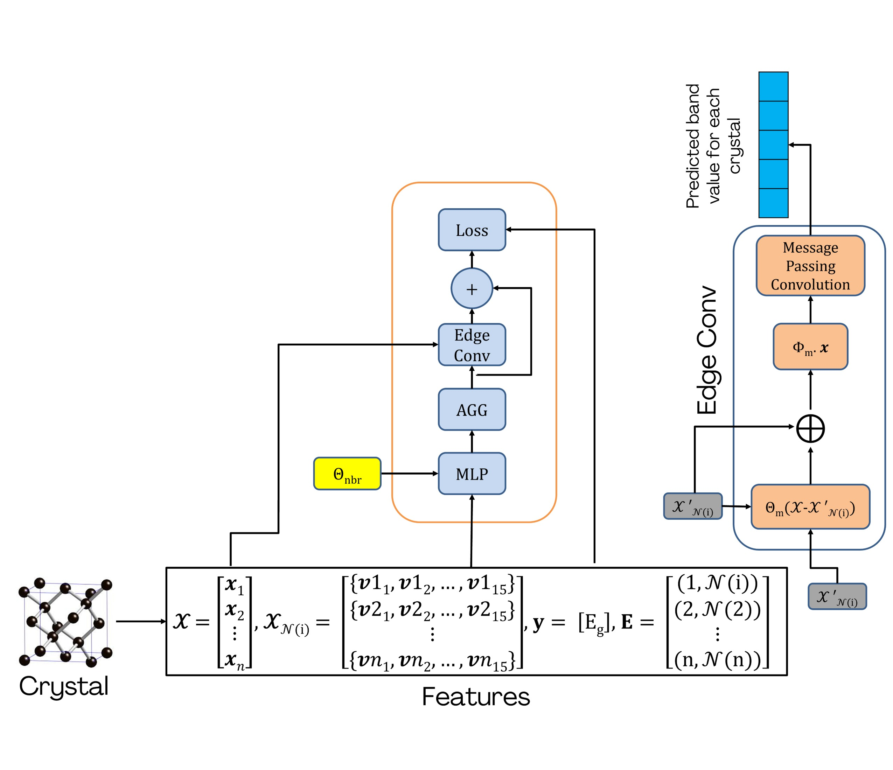

# Bridging Atomic and Bond Modalities: Crystal-X Network for Enhanced Bandgap Prediction

Welcome to the official GitHub repository for **Crystal-X** – an advanced graph neural network (GNN) model designed to accurately predict electronic band gaps in materials. This project builds upon the existing Crystal Graph Convolutional Neural Network (CGCNN) architecture by introducing edge-centered convolutions and a novel neighbor feature transformation.

---

# Abstract

Graph neural networks (GNNs) are key tools for predicting material properties at low computational cost by learning crystal structure representations. However, most approaches treat edge attributes as secondary to nodes despite bonds’ critical role in electronic properties. In this study, we introduce Crystal-X, a multimodal GNN architecture that connects atomic and bonding environments through edge-convolutional operations. Current node-centric models fall short in modeling complex bonding environments that determine bandgap values and other material properties. We analyze this limitation by exploring three aspects: performance across space groups, crystal centering types, and bandgap ranges. To address these identified shortcomings, we propose a simple solution: asymmetric edge convolutions with neighbor feature transformations, which directly supplement the missing bond information to GNNs. The resulting architecture achieves a bandgap prediction MAE of 0.26 eV on the Materials Project dataset—improving on CGCNN (0.39 eV), SchNet (0.42 eV), and MEGNet (0.33 eV)—with particular improvements for crystal materials for complex space groups (e.g., monoclinic systems, space groups 3–15), where bond interactions critically influence properties, and non-primitive centering types (e.g., face-centered lattices) with variable bond lengths. We implement granular analysis of the dataset, revealing the impact of data bias on learning and performance in underrepresented band gap classes, and 
identifying high-MAE outliers.

---


## Project Details

### Data Features Creation
- For generating dataset tensors, the algorithm proposed by CGCNN's authors was used. The original file can be viewed in their GitHub repo: https://github.com/txie-93/cgcnn

### Methodology
- **Model Architecture:** Builds upon CGCNN with the following key innovations:
  - **Neighbor Feature Transformation:** Transforms neighboring node features using a shared multi-layer perceptron (MLP).
  - **Asymmetric Edge Function:** Models directional atomic interactions via a learnable edge function.
  - **Edge Feature Aggregation:** Aggregates updated edge features to update node representations.
 


- **Training Details:**
  - **Optimizer:** AdamW, learning rate 1×10⁻⁴, weight decay 1×10⁻⁵ (×0.1 at epoch 100)
  - **Loss:** L2 (MSE) by default; L1 and SmoothL1 selectable with `--loss`
  - **Batch Size:** 256
  - **Convolutional Layers:** 6 (with batch normalization)
  - **Epochs:** 200
  - **Hardware:** NVIDIA RTX 4090 GPU, Intel Core i9 CPU

### Key Results

Crystal-X reaches **0.251 eV** MAE on Materials Project band gap.

**Matched-protocol benchmark.** Literature MAEs are reported on each model's own test
split, so they cannot be compared directly. We therefore retrained CGCNN and ALIGNN from
scratch alongside Crystal-X on the *same* MODNet MP_2018.6 data, the *same* 61,640/6,848
split, and evaluated all three on the *same* 6,848 test crystals:

| model | MAE (eV) | RMSE (eV) | R² | wallclock (1×A100) |
|---|---|---|---|---|
| **Crystal-X** | **0.2511** | **0.4983** | **0.9079** | 1.9 h |
| CGCNN | 0.2681 | 0.5105 | 0.9034 | 1.3 h |
| ALIGNN | 0.2632 | 0.5464 | 0.8893 | 11.5 h |

Crystal-X leads on all three metrics and in six of seven crystal systems, at ~1/6 of
ALIGNN's training cost. Full protocol, per-crystal-system and per-band-gap-range
breakdowns, trained weights, run logs and reproduction scripts are in
[`baselines/training/`](baselines/training/) — including a documented caveat that the
validation split is reused as the test split for all three models.

Under this matched protocol the commonly cited single-split figures shift: CGCNN performs
considerably better than its 0.39 eV literature value, and ALIGNN considerably worse than
its 0.22 eV, which was measured on a 4,239-material JARVIS `megnet` split sharing only
~11% of its materials with ours. Comparisons across published splits should be read with
that in mind.

- **Error analysis:** largest gains on metallic compounds (MAE 0.126 vs. CGCNN 0.137 and
  ALIGNN 0.152); wide-gap insulators remain the hardest class for all three models.

### Future Directions
- Predict additional electronic properties.
- Integrate Crystal-X into automated discovery pipelines.
- Expand and diversify the materials dataset to address biases.

---

### Baselines & Benchmark

[`baselines/training/`](baselines/training/) contains everything for the three-model
comparison: training scripts for Crystal-X, CGCNN and ALIGNN, the Slurm jobs used,
per-material test predictions for all three, trained weights, metric summary CSVs, the
per-space-group figure, and the run logs. All three models are evaluated on the same
6,848 test crystals, listed in [`splits/mp2018_benchmark.json`](splits/mp2018_benchmark.json).
Start with its README.

---

## Repository Layout

```
crystalx/model.py       Crystal-X model
crystalx/data.py        crystal-graph featurization and dataset loaders (MP 2018.6, MP 2022)
prepare_data.py         builds train/val/test tensor files
train.py                trains Crystal-X, or evaluates a checkpoint (--eval-only)
atom_init.json          per-element atom features
splits/                 MP 2018.6 benchmark split (train / test ids)
baselines/training/     Crystal-X vs. CGCNN vs. ALIGNN benchmark
```

## Setup

Tested on Linux with Python 3.12 and CUDA 12.8.

```bash
conda env create -f environment.yml
conda activate crystalx
```

`environment.yml` installs PyTorch 2.10.0 built for CUDA 12.8. For a different CUDA version, change the
`--extra-index-url` line to the matching wheel index from https://pytorch.org/get-started/locally/.

## Datasets

### MP 2018.6

The MODNet MP_2018.6 band-gap dataset (68,489 crystals) is on figshare:
https://figshare.com/articles/dataset/Materials_Project_MP_2018_6_MODData/12834275

```bash
curl -L -o MP_2018.6.zip https://ndownloader.figshare.com/files/24364571   # md5 06280c4e539508bbcc5266f07698f8d1
unzip MP_2018.6.zip MP_2018.6
python prepare_data.py mp2018 --moddata MP_2018.6 --out data/mp2018
```

This uses the benchmark split in `splits/mp2018_benchmark.json` (61,640 train / 6,848 test) and
holds out 10% of the dataset from the training ids for validation (`--val-ratio`).
`--val-ratio 0` validates on the test set, which is the protocol of the stored benchmark runs.

### MP 2022

Downloaded from the Materials Project API. Create a free account at
https://next-gen.materialsproject.org/ and copy your API key from the dashboard.

```bash
export MP_API_KEY=your_api_key
python prepare_data.py mp2022 --out data/mp2022
```

This downloads every material with a band gap and makes a seeded 80/10/10 train/val/test split.
The API serves the current database release, which is recorded in the tensor metadata; the ids of
each split are written to `data/mp2022/split.json`.

`prepare_data.py` uses all CPU cores by default (`--workers`). The MP 2018.6 tensors take about
15 GB of disk; MP 2022 needs roughly twice that. Both are loaded into RAM during training.

## Running

Train (6 layers, L2 loss, learning rate 1×10⁻⁴ by default):

```bash
python train.py --data-dir data/mp2018 --output-dir runs/mp2018
python train.py --data-dir data/mp2018 --output-dir runs/mp2018_l1 --loss l1
python train.py --data-dir data/mp2022 --output-dir runs/mp2022
```

Each run writes the best-on-validation checkpoint (`model_best.pth`) and per-crystal test
predictions (`test_results.csv`) to `--output-dir`. `python train.py --help` lists all options.

Evaluate a trained checkpoint, e.g. the released benchmark weights:

```bash
python train.py --data-dir data/mp2018 --output-dir runs/released \
    --eval-only baselines/training/results/crystalx_bandgap/model_best.pth
```

---

### How to Cite
Shehroz Ahmad Shoaib, Burhan SaifAddin. (2025). Bridging Atomic and Bond Modalities: Crystal-X Network for Enhanced Bandgap Prediction [Online]. Available: https://github.com/shehrozashoaib/Crystal-X

---

### Contact
For questions, collaborations, or further information:

Name: Shehroz Ahmad Shoaib
Email: s202353930@kfupm.edu.sa

Name: Burhan SaifAddin
Email: burhan.saifaddin@kfupm.edu.sa

